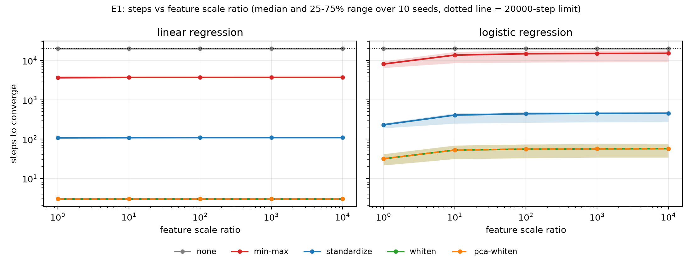
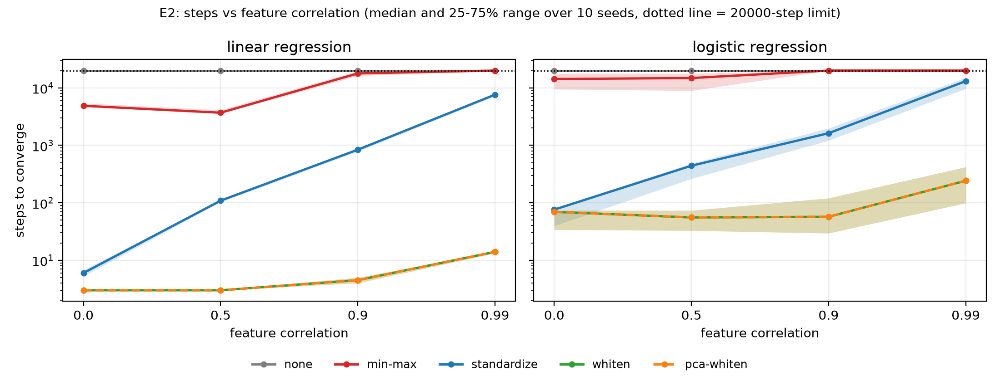
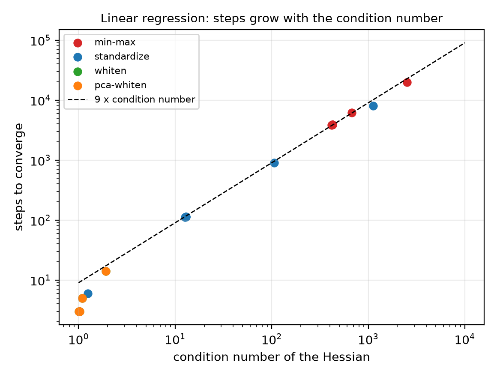

# Feature Scaling as Preconditioning for Gradient Descent

> How do standardization, min-max scaling and whitening change the Hessian and the convergence of gradient descent for linear and logistic regression, and what does each one cost?

**Team:** Nurana Aliyeva, Nijat Alaskarli, Ilknur Huseynova • **Course:** CSCI4734 Machine Learning, ADA University (Fall 2026) • **Topic:** 3, Feature scaling as preconditioning

---

## Quick start

```bash
# 1. Clone and install
git clone https://github.com/Nurana100/csci4734-feature-scaling-gd.git
cd csci4734-feature-scaling-gd
pip install -r requirements.txt

# 2. Check that the code works
python src/demo.py

# 3. Run the experiments (from the repo folder, results are saved to results/)
python src/experiment_e1.py      # steps vs feature scale ratio, seed 0
python src/experiment_e2.py      # steps vs feature correlation, seed 0
python src/experiment_seeds.py   # E1 and E2 over 10 seeds (takes about 10 minutes)

# 4. Make the figures
python src/plot_e1_e2.py         # seed-0 figures and the condition-number plot
python src/plot_seeds.py         # 10-seed summary table and figures
```

## Idea

Gradient descent is slow when features have very different scales or are correlated, because the loss surface becomes a long narrow valley. The number of steps grows in proportion to the condition number of the Hessian. Scaling the features changes the Hessian, so we measure how many steps each scaling method needs and how much it costs to compute. The fairness detail: the L2 penalty is transformed with the scaling, so every method solves the same optimization problem.

## Headline result

Linear regression, scale ratio 100, feature correlation 0.5, median over 10 seeds, stopping at objective gap below 1e-8:

| Scaler | Hessian condition number | Steps | Runs that converged |
|---|---|---|---|
| None | 786,192 | did not converge in 20,000 | 0 of 10 |
| Min-max | 445 | 3,695 | 10 of 10 |
| Standardization | 12.5 | 109 | 10 of 10 |
| Whitening | 1.0 | 3 | 10 of 10 |

## Figures

Median and 25-75% range over 10 seeds:





Steps grow in proportion to the Hessian condition number (seed 0, linear regression):



## Experiments

| ID | What it measures | Owner | Status |
|---|---|---|---|
| E1 | Steps to converge vs feature scale ratio (10 seeds, ratio 1 to 10^4) | Nurana | done |
| E2 | Steps to converge vs feature correlation (10 seeds) | Nurana | done |
| E3 | Learning-rate sensitivity | Nijat | in progress |
| E4 | Total cost: scaling time plus gradient descent time | Ilknur | in progress |
| E5 | L2 penalty equivalent across scalers | Nijat | in progress |

Derivations: D1 and D2 (Nurana, `report/D1_D2.txt`), D4 (Nijat), D5 (Ilknur).

## Repository structure

```
src/         code: data_gen.py, scalers.py, gd.py, experiment_e1.py, experiment_e2.py, experiment_seeds.py, plot_e1_e2.py, plot_seeds.py, demo.py
results/     CSV files, figures and short notes for each experiment
report/      report drafts and derivations
slides/      presentation
notebooks/   demo notebook
```

## Working in the repo

1. Run `git pull` before you start.
2. Commit your own files so your name shows in the history: `git add .`, `git commit -m "short message"`, `git push`.
3. If the push is rejected, run `git pull`, then `git push` again.
4. Do not edit `data_gen.py`, `scalers.py` or `gd.py` directly. Tell Nurana what to change.

## Deadlines

Results freeze: Dec 4 • Submission: Dec 14, 23:59
